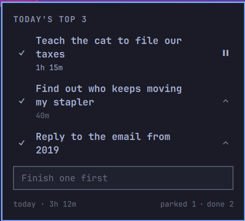

# Today's Top 3

An [Omarchy](https://omarchy.org/) status-bar widget for a daily task list capped at three active items on purpose. No backlog, no chat, no Eisenhower matrix — just three slots, a quick-add field, a focus timer for the top task, and a terminal-flavored completion animation.



## Why capped at 3

A fourth task doesn't get queued — it can't be added until you finish, drop, or reorder one of the existing three. The cap is the feature: it forces the tradeoff decision instead of letting the list grow the way every other to-do app does.

## What it does

- **Bar**: three pips (●●○) — filled slots vs. free ones. No task text, no variable width. Hover for a tooltip ("Today — 2 of 3", or the running task and its time). The pips only change colour when something needs you — see *Focus timer*.
- **Add**: type and hit Enter. Disabled with an explanatory placeholder once you're at 3 — finish or remove one first, there's no overflow list to dump a 4th into.
- **Complete**: ✓ plays a brief terminal-style `[ OK ]` tag before the task leaves the list.
- **Reorder**: an up-chevron promotes any task to the top (any order is reachable in at most two clicks with 3 items). The top task doesn't get a dead, do-nothing button — the control is simply absent, not disabled.
- **Edit**: click a task's text to edit it in place. The field wraps like the display text does, so a two-line task is fully visible while you edit it instead of scrolling.
- **Focus timer**: ▶ on the top task (only the top task — one thing at a time). Each task shows its total time across every day it's been on the list, and finished tasks keep theirs in the done list.
  - Pressing play makes the top pip breathe once; there's no permanent "running" colour.
  - After **90 minutes** of focus, all three pips turn red and one notification says to take a break. Only a **5-minute** stretch with nothing running resets that — a 4-minute pause carries the streak on.
  - **Locking the screen pauses** immediately. **Sleep, crashes, and shell restarts** end the session at the last 10-second heartbeat, so time asleep is never counted.
  - If you're back at the keyboard after a break but haven't restarted, the top pip turns **amber**. Opening the panel dismisses it.
  - Promoting another task pauses the timer; the new top task waits for its own play press.
- **Park**: hover a task for a park button. It frees the slot when something urgent comes up, without throwing the task away. Only **one** task can be parked at a time and it never expires — it waits behind `parked 1` in the footer until you bring it back (↺, needs a free slot) or drop it (✕). Parking the running task pauses it.
- **Footer**: one quiet line under the input — `today · 3h 12m` on the left (click to cycle week, Monday start, month, and year; resets to today on every open), and `parked 1 · done 3` on the right. Each toggle only appears when it has something in it, and opens its list below the footer, one at a time.
- **Recently done**: collapsed by default behind `done n` in the footer — expand on click to see struck-through entries with restore (↺, mirrored `[ << ]` tag animation) and clear (✕) actions. Capped at the 3 most recent, and cleared automatically at local midnight regardless of count.
- **All clear**: finishing your last task for the day types out "All clear ✓" instead of just popping in — a slightly bigger payoff reserved for the rarer, bigger moment.
- Fully local: no network calls, no AI, no telemetry, ever.

## Data

Task state lives at `~/.local/state/omarchy/todays-top-3.json`, *not* inside this repo — so cloning, forking, or publishing this code can never expose your actual task content. The containing directory and the file itself are both locked to owner-only permissions (`700`/`600`).

Time stats live next to it in `todays-top-3-history.json` (also `600`) as daily totals only — `{ "2026-10-16": 11520 }` — with no task names, so the history records how much you worked, never on what.

## Install

Clone or symlink this repo into `~/.config/omarchy/plugins/todays-top-3/`, then:

```bash
omarchy plugin enable io.github.hannoammermann.todays-top-3
```

Place it in your bar via `~/.config/omarchy/shell.json`'s `bar.layout` section, or `omarchy bar move`.

## License

MIT — see [LICENSE](LICENSE).
