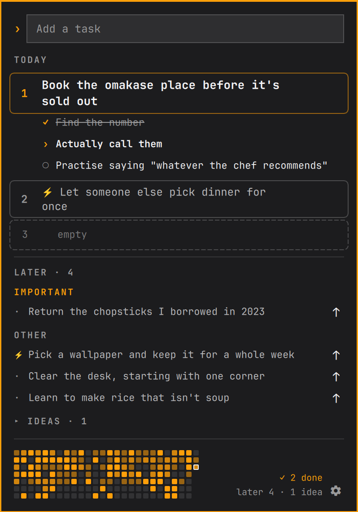

# Today's Top 3

**Three things a day, one at a time.** An [Omarchy](https://omarchy.org/) bar widget for when your to-do list keeps winning.

- **Three slots for today, Later for the rest.** Long lists feel productive and get little done. Today holds three; anything else you think of goes to Later in one keystroke, so it's written down and out of your head.
- **One thing at a time.** #1 is the one you're on. To switch, make another task #1: choosing and focusing become the same decision.
- **Progress you can see.** Finishing a task burns it away, and a small dot map fills in day by day — no points, no streaks to lose.

All of it lives in three dots in your bar. No chat, no Eisenhower matrix, no network.



## What it does

- **Capture first**: the panel opens with the cursor in the input (bind a key to `omarchy-shell shell toggle io.github.hannoammermann.todays-top-3`). Enter adds a task, or saves the text to **Later** once Today has 3, so writing a thought down is never blocked.
- **Today, 3 slots**: order is priority. Hover a task and press ↑ to focus on it (it becomes #1), whether it's the important one or an easy one to get going.
- **Steps**: press Tab instead of Enter to add the text as a step of the top task (up to 5, one level). The top task shows its steps with the next open one in bold; the others show `1/3`.
- **Sorting Later**: Later has three groups — Important, the rest, and Ideas (folded away, not counted). Hover an item for ☆ important, 💡 idea and ⚡ quick win. In the note they are just headings (`## Important`, `## Later`, `## Ideas`) and a ⚡ at the end of a line.
- **Later**: hover a task to move it to Later. Whenever a slot is free, Later shows right under Today, so planning the day is just ↑. ✕ drops an item.
- **Done**: ✓ burns the row away in dither blocks. Finished tasks fold into one line ("✓ 2 done today") until midnight, without taking a slot; open it and click one to undo.
- **Dot strip**: half a year of finished tasks as small dots in the footer, today outlined; `✓ n done` next to it opens today's finished tasks.
- **Age**: a task waiting since an earlier day shows how long (`3d`).
- Fully local: no network calls, no AI, no telemetry.

## Data

Today, Later and a Done log live in one markdown note:

```markdown
## Today
- [ ] Update CTA button
  - [x] Get new copy
  - [ ] Swap the button

## Important
- [ ] Renew passport

## Later
- [ ] Compare NAS boards
- [ ] Bank run ⚡

## Ideas
- [ ] Home bar

## Done
- [x] 2026-11-25 Send the weekly update (2 steps)
```

By default the note is `~/.local/state/omarchy/todays-top-3.md`, private to this machine (`600`). You can edit it by hand; the panel picks up changes within a second. Ticking a box counts as done, indented checkboxes are steps, more than 3 Today lines spill over into Later, and Done entries older than 30 days are dropped.

**Sync (optional, off by default).** In the widget's settings, turn on *Sync with a note* and choose a `.md` file inside any synced folder: a notes vault (Obsidian and similar), Syncthing, Dropbox. Your lists then show up, and can be edited, on your other devices. The task text then goes wherever that folder syncs; the plugin itself still makes no network calls. Turning sync off copies the current lists back to the local note. Note: sync tools that run inside an app (e.g. an Obsidian sync plugin) only pick up changes while that app is running.

Machine-local state stays in `todays-top-3.json` (today's done list, ids, dates) and `todays-top-3-history.json` (tasks finished per day, no names), both `600`. Upgrading from 0.2 moves your tasks and parked item into the note automatically.

## Install

```bash
omarchy plugin add https://github.com/hannoammermann/todays-top-3.git --enable
```

Or clone this repo into `~/.config/omarchy/plugins/todays-top-3/` yourself and run `omarchy plugin enable io.github.hannoammermann.todays-top-3`. Move it around the bar with `omarchy bar move`, or via `bar.layout` in `~/.config/omarchy/shell.json`.

## Remove

```bash
omarchy plugin remove io.github.hannoammermann.todays-top-3
```

That removes the plugin itself. Your tasks and time history stay behind in case you reinstall; to delete them too:

```bash
rm ~/.local/state/omarchy/todays-top-3.json ~/.local/state/omarchy/todays-top-3.md ~/.local/state/omarchy/todays-top-3-history.json
```

The plugin never edits your shell or Hyprland config.

## Dependencies and permissions

Nothing to install beyond a standard Omarchy setup. Like all Omarchy plugins it runs unsandboxed as your user; this is everything it touches:

- Reads and writes only the files above (and the note path you choose, if sync is on).
- Runs `hyprctl binds -j` when the panel opens (to show your shortcut in the tip) and `omarchy bar set` when you change a setting in the panel.

## License

MIT — see [LICENSE](LICENSE).
